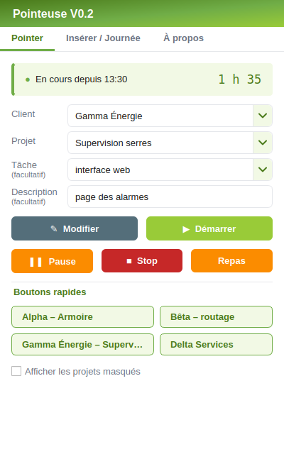
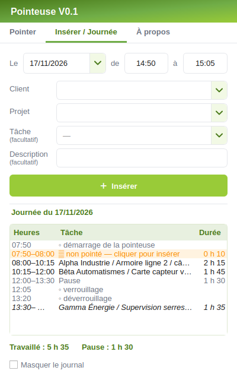
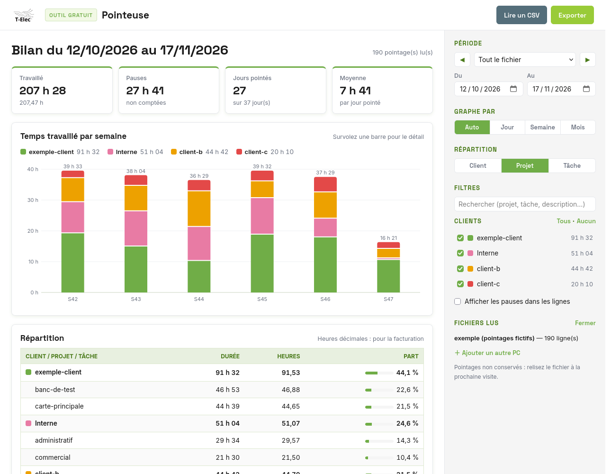

# Pointeuse

**Pointez votre temps par client, projet et tâche, sans quitter ce que vous faites.**

Une icône horloge dans la zone de notification (Windows et Linux) ouvre un petit
panneau : un clic pour démarrer une tâche, un clic pour la pause, un clic pour
s'arrêter. Tout est écrit dans un simple fichier CSV, et un bilan s'ouvre dans le
navigateur pour facturer ou faire le point de la semaine.

Rien n'est envoyé nulle part : les données restent sur votre poste.

<p align="center">
  
  &nbsp;&nbsp;
  
</p>

## Ce qu'elle fait

### Pointer en un clic

- **Démarrer** une tâche : client, projet, tâche (facultative) et description libre.
  Démarrer une autre tâche clôture automatiquement la précédente.
- **Modifier** la tâche en cours sans la couper : préciser le projet ou la
  description après coup, l'heure de début est conservée.
- **Pause**, **Repas** (une pause notée « Repas ») et **Stop** pour la fin de journée.
- **Boutons rapides** pour les tâches régulières : un clic et c'est parti. Avec le
  client seul, le champ Projet passe en rouge tant qu'il reste à compléter.
- Les listes Client / Projet / Tâche se remplissent toutes seules à partir de ce
  que vous tapez.

### Ne rien oublier

- **Veille ou session verrouillée** : la tâche est mise en pause à l'heure du départ ;
  au retour, une fenêtre demande ce que vous avez fait.
- **Absence longue** (nuit, plus de 4 h) : la tâche est clôturée au départ, sans question.
- **Plantage ou coupure** : la tâche en cours est sauvegardée toutes les 5 minutes et
  reprise au redémarrage.
- **Vue Journée** : les lignes du jour, les totaux, et les moments où le PC était
  utilisé sans rien de pointé (en orange) — un clic dessus prépare l'insertion.
- **Insérer** une tâche à heures fixes après coup : elle découpe ce qu'elle recouvre,
  jamais deux choses en même temps.

### Faire le bilan

Menu de l'icône → **Bilan** : le CSV s'ouvre dans le navigateur, déjà chargé, hors
connexion. Temps par client, projet ou tâche, par jour, semaine ou mois, heures
décimales pour la facturation, export CSV.

<p align="center">
  
</p>

**Plusieurs PC ?** Le bilan fusionne les CSV autour d'un PC principal : un temps
pointé sur deux postes à la fois n'est compté qu'une fois, et le détail de ce qui
a été retiré est affiché.

## Installation

1. Télécharger le zip de votre système dans les
   [Releases](https://github.com/mattpatt59/Pointeuse/releases).
2. Le dézipper où vous voulez (par exemple `Documents/` ou `C:\pointeuse\`).
3. Lancer `Pointeuse` (`Pointeuse.exe` sous Windows) dans le dossier `Pointeuse/`.

Pas d'installateur, pas de droits administrateur. Le CSV et la configuration sont
créés dans le dossier `data/`, à côté de l'exécutable. Pour le lancer à chaque démarrage : menu de l'icône →
« Lancer à l'ouverture de session ».

- **Windows** : l'exécutable n'est pas signé, SmartScreen peut avertir au premier lancement.
- **Linux (Ubuntu GNOME)** : l'icône demande l'extension AppIndicator ; si Qt réclame
  `libxcb-cursor0` : `sudo apt install libxcb-cursor0`.

## Les fichiers

| Fichier | Rôle |
|---------|------|
| `pointeuse.csv` | Les pointages : début, fin, client, projet, tâche, description, durée en minutes. Lisible dans un tableur. |
| `pointeuse_config.toml` | Clients, projets, tâches et boutons rapides. Se modifie à la main, relu automatiquement. |
| `pointeuse_journal.csv` | Événements du poste (démarrage, verrouillage, veille…), gardés 90 jours. |

Exemple de boutons rapides dans `pointeuse_config.toml` (8 au plus) :

```toml
[[raccourcis]]
nom = "Administratif"
client = "Perso"
projet = "administratif"

[[raccourcis]]
nom = "26-01_routage"
client = "Client A"
projet = "26-01-Projet"
tache = "Routage"
```

Fichier commenté complet : [docs/exemples/pointeuse_config.toml](docs/exemples/pointeuse_config.toml).

## Pour aller plus loin

- Guide d'utilisation : [docs/user/pointeuse.md](docs/user/pointeuse.md)
- Spécification : [docs/cdc/pointeuse.md](docs/cdc/pointeuse.md)
- Vue d'ensemble du projet et développement : [docs/readme.md](docs/readme.md)
- Historique des versions : [VERSION.md](VERSION.md)

## Licence

[MIT](LICENSE) — logiciel libre, développé par [T-Elec](https://t-elec.fr/), bureau
d'études électronique à Lille. L'exécutable distribué inclut PySide6 (Qt), sous
licence LGPL v3 : voir `LICENCES_TIERS.md` dans l'archive
([licences/](licences/) dans le dépôt).
